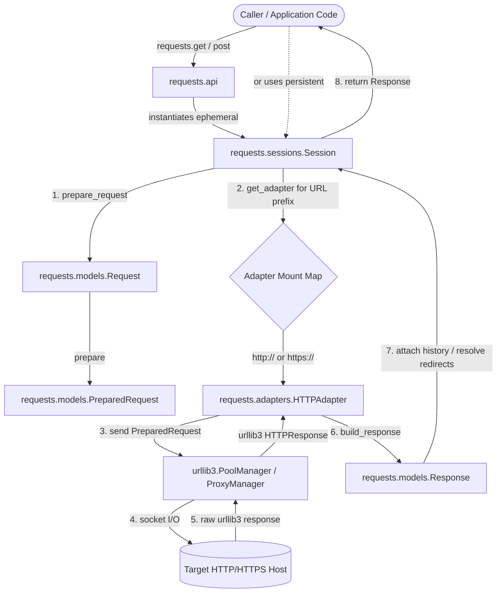

# Architecture: `psf/requests`

Requests is organized into four distinct layers:

1. **Facade Layer (`requests.api` & `requests.__init__`)**: Convenience functions (`get`, `post`, `put`, `delete`, `head`, `options`, `patch`, `request`) that manage ephemeral `Session` instances.
2. **Session & Orchestration Layer (`requests.sessions`)**: Maintains cookies across requests, stores auth/header defaults, resolves redirects (`SessionRedirectMixin`), and routes requests to transport adapters based on URL prefixes.
3. **Data Model Layer (`requests.models`)**:
   - `Request`: Raw request configuration supplied by caller.
   - `PreparedRequest`: Immutable request payload (headers formatted, body encoded, URL canonicalized with query parameters, cookies attached) ready for socket dispatch.
   - `Response`: Encapsulates status code, headers, cookies, raw byte streaming (`iter_content`), text decoding (`text`), and redirect history.
4. **Transport Layer (`requests.adapters` & `urllib3`)**:
   - `BaseAdapter`: Abstract contract for transport handlers.
   - `HTTPAdapter`: Concrete adapter that manages `urllib3.PoolManager` and `urllib3.ProxyManager`, translates `PreparedRequest` into `urllib3` calls, and packages the result into a `Response`.

---

## Architectural Workflow Diagram

---

## Key Architectural Decisions & Evidence

### 1. Ephemeral vs. Persistent Sessions
- **Evidence:** `src/requests/api.py:14-64`
- Calling `requests.get()` opens an ephemeral `with sessions.Session() as session:` block. Each top-level call builds and tears down a connection pool unless the caller explicitly uses `requests.Session()`.

### 2. URL Prefix Adapter Dispatch
- **Evidence:** `src/requests/sessions.py:734-754` (`Session.get_adapter`)
- Sessions store an ordered dictionary of adapters mounted to prefixes (`self.adapters = CaseInsensitiveDict()`). Standard setup mounts `https://` and `http://` to default `HTTPAdapter` instances. Custom adapters can be mounted for custom schemes or specific domains.

### 3. Preparation Pipeline
- **Evidence:** `src/requests/models.py:277-505` (`PreparedRequest.prepare`)
- Preparation occurs sequentially: `prepare_method`, `prepare_url`, `prepare_headers`, `prepare_cookies`, `prepare_body`, `prepare_auth`, `prepare_hooks`. Each step mutates only the `PreparedRequest` instance.
